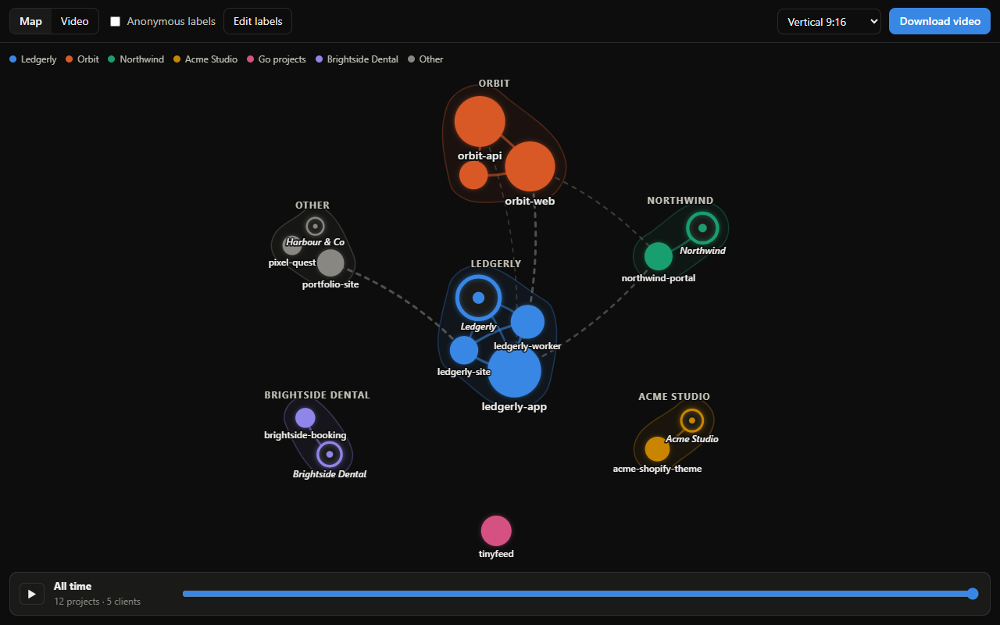
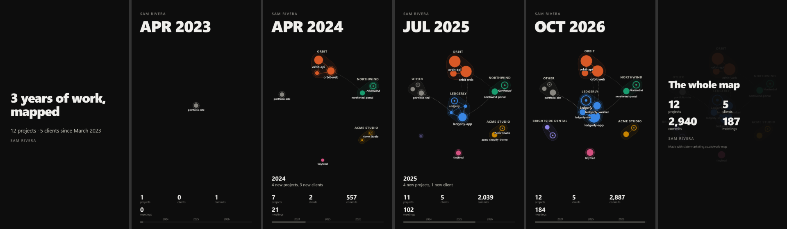

# work-map

Your work as a map: every project and client, how they connect, and how it all grew, month by month. Explore it, then download it as a video to post.





**Try it in your browser:** [slatermarketing.co.uk/work-map](https://slatermarketing.co.uk/work-map). Connect GitHub, or type a username.

**Or run it on your own machine**, from the git repos on your computer, with no sign-in:

```sh
npx github:SlaterMarketing/work-map ~/code
```

It writes `work-map.html`. Open it in Chrome, Edge or Safari.

## What it shows

- **Projects** (filled circles): your repos, sized by how much you've done on them.
- **Clients** (rings): from your calendar, if you add it. Anyone at an outside company you've met at least twice.
- **Links** between them:
  - a shared name, like `orbit-api` and `orbit-web`
  - a client's name in a project's name or description
  - one project naming another in its README or `package.json`
  - a shared stack: the same dependencies and topics (dashed)
- **Families**: groups of linked projects and clients, each with its own colour.
- **The timeline**: things appear when you first worked on them, and pulse in the months you were busy with them.

The video is the timeline played out, with the month, running totals (projects, clients, commits, meetings) and captions for each year, in vertical (9:16), square or landscape (16:9).

## Private by default

- **Nothing is uploaded.** The CLI only reads files on your computer. In the browser, your repos are read straight from GitHub by your browser, and the video is made in your browser too.
- **Anonymous labels are on by default.** Clients become "Client A", private repos become "TypeScript project", and families named after something private become "Product A". Public repos keep their names. Edit any label, or hide anything, before you download.
- The CLI's HTML file has no local paths in it. It does contain your repo and client names, so that you can switch between real and anonymous labels. Share the video, not the HTML file.

## CLI

```
work-map [folders...] [options]

  --author <email>   your commit email; repeat for more (default: git config user.email)
  --ics <file>       calendar export (.ics, or Google Calendar's .zip) to add clients; repeatable
  --name <name>      the name on the video (default: git config user.name)
  --out <file>       where to write the map (default: work-map.html)
  --json <file>      also write the data as JSON
  --depth <n>        how many folders deep to look for repos (default: 3)
  --since <YYYY-MM>  start the timeline here
  --real-names       start with real labels instead of anonymous ones
```

It looks in every branch and counts each commit once, so a repo copied from another doesn't count its history twice.

To add clients, export your calendar. In Google Calendar that's Settings → Import & export → Export, which gives you a .zip. Outlook and Apple Calendar can export .ics files.

## Use it in your own page

```sh
npm install github:SlaterMarketing/work-map
```

```js
import { collectGitHub, clientsFromCalendar, mountStudio } from 'work-map';

const data = await collectGitHub({ user: 'octocat' });        // or { token } for private repos
data.items.push(...clientsFromCalendar(icsText).items);      // optional
mountStudio(document.getElementById('app'), data, { credit: 'Made with work-map' });
```

Or with a script tag, after `npm run build`: `dist/work-map.js` puts everything on `window.WorkMap`.

The pieces, if you want to build your own interface:

| | |
|---|---|
| `collectGitHub({ token, user, onProgress })` | Data from GitHub. With a token it reads every repo the token can see; without one it reads a user's 20 most recently active public repos (GitHub allows 60 requests an hour without signing in). |
| `clientsFromCalendar(texts, { ownDomains })` | Client items from .ics text. `icsFromZip(buffer)` unpacks Google's export. |
| `buildGraph(data, { labels, hidden })` | Families, links and the layout. Same data, same map, every time. |
| `anonymousLabels(graph)` | Label overrides that hide clients and private work. |
| `mountMap(el, graph)` | The interactive map on its own. |
| `createVideo(graph, { format })` | The video: `draw(ctx, frame)` draws any frame. |
| `exportVideo(video)` | Encodes it as MP4 (H.264) with WebCodecs, or WebM where the browser can't do H.264. |

### The data format

```js
{
  version: 1,
  name: 'Sam Rivera',
  generated: '2026-10-28',          // the last month shown
  items: [
    { id: 'gh:sam/orbit-api', label: 'orbit-api', kind: 'project', language: 'TypeScript', public: false,
      tags: ['express', 'prisma'], series: { commits: { '2024-03': 41, '2024-04': 18 } } },
    { id: 'cal:northwind.io', label: 'Northwind', kind: 'client', domain: 'northwind.io',
      series: { meetings: { '2024-03': 3 } } },
  ],
  links: [{ source: 'gh:sam/orbit-api', target: 'cal:northwind.io', kind: 'client', weight: 0.7 }],
}
```

Series can be `commits`, `meetings` or `emails`. Anything you can count by month can go in, so you can add sources of your own. `examples/sample.json` is a made-up example.

## Developing

```sh
npm install
npm test               # unit tests
npm run build          # dist/work-map.js
node scripts/demo.mjs  # examples/demo.html, from the sample data
```

`node scripts/check.mjs <dir>` opens the demo in Chrome, saves screenshots and video frames to `<dir>`, and times a full video export.

## Licence

MIT. Made by [Will Slater](https://slatermarketing.co.uk).
